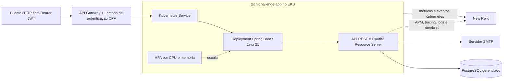
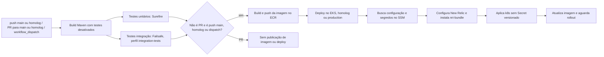

# Tech Challenge Fase 3 — Grupo 15 (Pós FIAP/SOAT)

## Propósito

API REST para gerenciamento de uma oficina mecânica: clientes e veículos, ordens de serviço (OS), orçamentos, estoque e acompanhamento do status. Este repositório contém a aplicação Java/Spring Boot, os manifests Kubernetes da aplicação e seus workflows de CI/CD. A API é executada no EKS e usa banco PostgreSQL gerenciado; o banco não é executado por StatefulSet neste repositório.

## Tecnologias

| Tecnologia | Versão/uso confirmado |
|---|---|
| Java | 21 |
| Spring Boot | 3.5.15-SNAPSHOT |
| Spring Security e OAuth2 Resource Server | Autorização e validação JWT |
| Spring Data JPA | Persistência |
| PostgreSQL | Driver de runtime; container local `postgres:16-alpine`; banco gerenciado no ambiente Kubernetes |
| Flyway | 11.7.2; migrações na inicialização |
| Springdoc OpenAPI | 2.8.16 |
| Actuator | Health check e integração com probes |
| Maven Wrapper | Build e testes |
| Docker / Docker Compose | Imagem e ambiente local |
| Testcontainers, Cucumber, WireMock e ArchUnit | Dependências de teste declaradas no `pom.xml` |

## Diagrama da arquitetura



A Lambda recebe o fluxo de autenticação por CPF e emite o JWT; a aplicação valida o token recebido. O `SecurityConfig` valida JWT HS256 usando `app.jwt.secret` (configurado pela variável `JWT_SECRET`) e converte a claim `role` em autoridade `ROLE_<role>`. A aplicação é stateless. `/ping`, `/actuator/health/**`, `/auth/login`, Swagger e `/api/public/**` são liberados pela configuração; as demais requisições exigem autenticação.

## Passos de execução e deploy

### Execução local

Pré-requisitos: Java 21 e Docker com Docker Compose. O compose principal executa a API, PostgreSQL local, WireMock e MailHog. Configure `.env` com os nomes de variáveis abaixo e inicie:

```bash
docker compose up --build
```

- API: <http://localhost:8080>
- Swagger UI local: <http://localhost:8080/swagger-ui.html>
- Health: <http://localhost:8080/actuator/health>
- MailHog: <http://localhost:8025>

O banco local é exposto na porta `5433`; a aplicação no compose conecta ao serviço `postgres` na rede Docker. Para iniciar somente os serviços de apoio definidos no compose de desenvolvimento:

```bash
docker compose -f docker-compose.dev.yml up
```

Principais variáveis referenciadas pela configuração e pelos manifests: `DB_NAME`, `DB_USER`, `DB_PASS`, `SPRING_DATASOURCE_URL`, `SPRING_DATASOURCE_USERNAME`, `SPRING_DATASOURCE_PASSWORD`, `JWT_SECRET`, `MAIL_HOST`, `MAIL_PORT`, `MAIL_USERNAME`, `MAIL_PASSWORD`, `MAIL_FROM` e `FLYWAY_ENABLED`. Não grave valores de credenciais em arquivos versionados.

### Testes

```bash
./mvnw test
```

O `pom.xml` configura Failsafe apenas no perfil `integration-tests`. Portanto, o comando acima executa a fase padrão do Maven e não executa os testes Failsafe. Para a fase de integração usada no CI:

```bash
./mvnw verify -Pintegration-tests -Dsurefire.skip=true
```

Gerar relatório JaCoCo:

```bash
./mvnw clean test jacoco:report
```

O job unitário do workflow exclui `CucumberRunnerTest` e classes `*IT`; Cucumber, portanto, não é executado por esse job. A etapa de integração ativa o perfil Failsafe explicitamente.

### Kubernetes / EKS

O cluster EKS e o banco gerenciado precisam estar provisionados pelos repositórios de infraestrutura. Os manifests deste repositório configuram a aplicação, Service `LoadBalancer`, Ingress, HPA e PDB; não há StatefulSet de PostgreSQL. O Deployment recebe `SPRING_DATASOURCE_URL` e configurações não sensíveis pelo ConfigMap, e credenciais por Secret.

Para aplicar os manifests manualmente no cluster:

```bash
aws eks update-kubeconfig --region us-east-1 --name eks-tech-challenge
kubectl apply -k k8s/
```

O workflow também atualiza a imagem do Deployment e aguarda o rollout. Consulte [`k8s/README.md`](k8s/README.md) para o fluxo local com Kind; esse ambiente precisa de um PostgreSQL acessível configurado para a aplicação.

## Pipeline CI/CD

O workflow [pipeline.yml](.github/workflows/pipeline.yml) é acionado por `push` para `main` ou `homolog`, `pull_request` com destino a uma dessas branches e `workflow_dispatch`.



O job de build executa `clean package -DskipTests`. Os jobs unitário e de integração dependem dele e são pré-requisitos para publicar imagem. O ECR recebe tags com o SHA do commit e `latest`. Em push para `homolog`, o deploy usa o environment `homolog`; em `main`, usa `production`. O workflow lê configurações do SSM, cria os Secrets/ConfigMaps da aplicação e do New Relic, instala/atualiza o `nri-bundle`, aplica os manifests sem reaplicar o Secret de placeholders, atualiza a imagem e aguarda o rollout por até 600 segundos. PRs não publicam imagem nem fazem deploy.

O workflow [sonar.yml](.github/workflows/sonar.yml) roda em `push` para `main` e `feature/**`, e em `pull_request` para `main`; executa `verify` e análise SonarCloud.

## Fluxo de branches

- O workflow roda em `push` e em PRs direcionados a `homolog` e `main`.
- PRs executam build e testes; publicação de imagem/deploy ocorrem após `push` para `homolog` (environment `homolog`) ou `main` (environment `production`), além de `workflow_dispatch`.
- O fluxo documentado pelo projeto é feature → PR para `homolog` → deploy de homologação → PR de `homolog` para `main` → deploy de produção. A obrigatoriedade de PR, proteção das branches e regras de aprovação dos environments não são configuradas nos workflows consultados: [AJUSTAR].

## Observabilidade

O New Relic foi escolhido como plataforma central de observabilidade pela ampla faixa de uso gratuito. Neste repositório, o agente Java APM e a integração Kubernetes são configurados pelo pipeline; a instrumentação da API inclui tracing distribuído, logs e métricas de negócio.

- O `pom.xml` declara `newrelic-api` 8.25.1 e Actuator. O Dockerfile adiciona o Java agent à imagem; o Deployment o ativa com `JAVA_TOOL_OPTIONS`.
- O pipeline obtém `NEW_RELIC_LICENSE_KEY` dos GitHub Secrets e cria o Secret `newrelic-license` e o ConfigMap `newrelic-config`, com nome da aplicação e ambiente (`homolog`/`production`). A chave não é versionada.
- O Deployment habilita distributed tracing e encaminhamento de logs com dados de contexto do MDC. O `requestId` é propagado nos logs. Metadados de cluster, nó, namespace, pod, Deployment e container acompanham as transações.
- O pipeline instala/atualiza `newrelic/nri-bundle` no namespace `newrelic` para métricas e eventos Kubernetes. O logging do bundle está desabilitado para evitar duplicidade; os logs são encaminhados pelo agente APM.
- Há métricas de negócio relacionadas a OS e ao tempo nos status, enviadas à API do New Relic. Detalhes e dashboard estão em [`docs/observability.md`](docs/observability.md) e [`docs/newrelic/dashboard.json`](docs/newrelic/dashboard.json).
- O health check `/actuator/health` é usado nas probes; o HPA escala por CPU conforme o manifesto atual.
- A cobertura de observabilidade da Lambda/API Gateway e do PostgreSQL gerenciado não é configurada por este repositório: [AJUSTAR] confirmar a instrumentação nos respectivos repositórios.

## Endpoints principais

| Área | Endpoints |
|---|---|
| Autenticação | `POST /auth/login`; `GET /me` |
| Clientes | `POST /clientes`; `GET /clientes`; `GET /clientes/{cpfCnpj}`; `PUT /clientes/{cpfCnpj}`; `DELETE /clientes/{cpfCnpj}` |
| Veículos | `POST /veiculos`; `GET /veiculos`; `GET /veiculos/{placa}`; `PUT /veiculos/{placa}`; `DELETE /veiculos/{placa}` |
| OS | `POST /api/v1/ordens-servico/criar`; `GET /api/v1/ordens-servico/listar-os`; `GET /api/v1/ordens-servico/listar-os-priorizadas`; `GET /api/v1/ordens-servico/buscar?id={id}`; `PUT /api/v1/ordens-servico/editar?id={id}`; `DELETE /api/v1/ordens-servico/deletar?id={id}`; `PATCH /api/v1/ordens-servico/alterar-status?id={id}` |
| Orçamentos | `POST /api/v1/ordens-servico/criar-orcamento?id={id}`; `GET /api/v1/ordens-servico/buscar-orcamento?idOS={id}&idOrcamento={orcamentoId}`; rotas públicas `/api/public/atendimento/ordens/{id}/...` |
| Relatórios | `GET /api/os/atendimento/relatorios/ordens-servico`; `GET /api/os/atendimento/relatorios/ordens-servico/por-status` |
| Acompanhamento | `GET /clientes/{clienteId}/ordens`; `GET /clientes/{clienteId}/ordens/{osId}` |
| Estoque | `POST /estoque/itens`; `GET /estoque/itens`; `GET /estoque/itens/{id}`; `PUT /estoque/itens/{id}`; `DELETE /estoque/itens/{id}`; `GET /estoque/itens/abaixo-do-minimo`; `POST /estoque/itens/entrada`; `PATCH /estoque/itens/{id}/entrada`; `PATCH /estoque/itens/{id}/saida`; `GET /estoque/movimentacoes/item/{pecaInsumoId}` |

Consulte o Swagger local para os parâmetros e contratos completos.

## Ordem entre repositórios e parâmetros SSM

1. Provisionar a rede, o EKS e o ECR pelo [tech-challenge-infra-k8s](https://github.com/postech-grupo-16/tech-challenge-infra-k8s) e o banco gerenciado pelo [tech-challenge-infra-db](https://github.com/postech-grupo-16/tech-challenge-infra-db).
2. Implantar esta API no EKS. O Service `LoadBalancer` expõe o endpoint público que o API Gateway usa para encaminhar chamadas à aplicação.
3. Configurar/deployar a autenticação CPF e o API Gateway pelo [tech-challenge-auth-lambda](https://github.com/postech-grupo-16/tech-challenge-auth-lambda), apontando a integração para o endpoint da API. Essa sequência decorre da dependência do Gateway no endpoint público da aplicação; os workflows deste repositório não orquestram o outro repositório.

Este repositório não publica parâmetros SSM. O workflow consome parâmetros por ambiente, usando `/tech-challenge` para `main`/produção e `/tech-challenge-homolog` para `homolog`:

- `ecr_repository_name` e `eks_cluster_name`;
- `rds_endpoint`, `rds_port`, `rds_db_name`, `rds_user`, `rds_password` e `jwt_secret`.

Os dados do banco e o JWT são montados no Secret Kubernetes pelo workflow. `MAIL_USERNAME`, `MAIL_PASSWORD` e `NEW_RELIC_LICENSE_KEY` são obtidos de GitHub Secrets, não do SSM.

## Links

- Swagger local: <http://localhost:8080/swagger-ui.html>
- Coleções [Postman](postman/): [acompanhamento](postman/acompanhamento.collection.json), [atendimento](postman/atendimento.collection.json), [estoque](postman/estoque.collection.json) e [coleção completa](postman/Tech-Challenge-Completa-Production.collection.json).
- [Coleção Insomnia](Insomnia_Collection_TechChallenge.json)
- [Documentação arquitetural](docs/README.md): [diagrama de componentes](docs/component-diagram.md), [sequência de autenticação e OS](docs/sequence-auth-os.md), [diagrama ER](docs/er-diagram.md), [ADRs](docs/adrs/) e [RFCs](docs/rfcs/).
- [tech-challenge-infra-k8s](https://github.com/postech-grupo-16/tech-challenge-infra-k8s): rede, EKS e ECR.
- [tech-challenge-infra-db](https://github.com/postech-grupo-16/tech-challenge-infra-db): banco de dados gerenciado.
- [tech-challenge-auth-lambda](https://github.com/postech-grupo-16/tech-challenge-auth-lambda): autenticação CPF e API Gateway.
- [Quadro Trello do Grupo 15](https://trello.com/invite/b/69ff9b3fbdc96ebfe1808af1/ATTI5333882e6d64dcfb121c2fc69a608ec05F0B8F04/grupo-15-soat)

## Solução de problemas

- **Checksum de migration Flyway divergente:** para o banco local descartável, `docker compose down -v` remove o volume e os dados; depois execute `docker compose up --build` para reaplicar as migrations.
- **Kind falha ao iniciar com erro de cgroup no WSL2:** o guia de Kubernetes recomenda a imagem `kindest/node:v1.31.2` ou habilitar cgroup v2 no WSL2.
- **Pod não fica pronto:** confira os logs do Deployment e o acesso ao PostgreSQL configurado em `SPRING_DATASOURCE_URL`; a probe usa `/actuator/health` e o health check de e-mail está desabilitado no ConfigMap.
- **`ErrImageNeverPull` no Kind:** carregue a imagem local no cluster com `kind load docker-image` antes de aplicar os manifests.
- **Portas locais ocupadas:** confira `8080` (API), `5433` (PostgreSQL), `8081` (WireMock), `1025`/`8025` (MailHog) e `5005` (debug da aplicação no compose principal).

Desenvolvido como Tech Challenge — Pós-Graduação em Arquitetura de Software (FIAP/SOAT), Grupo 15.
