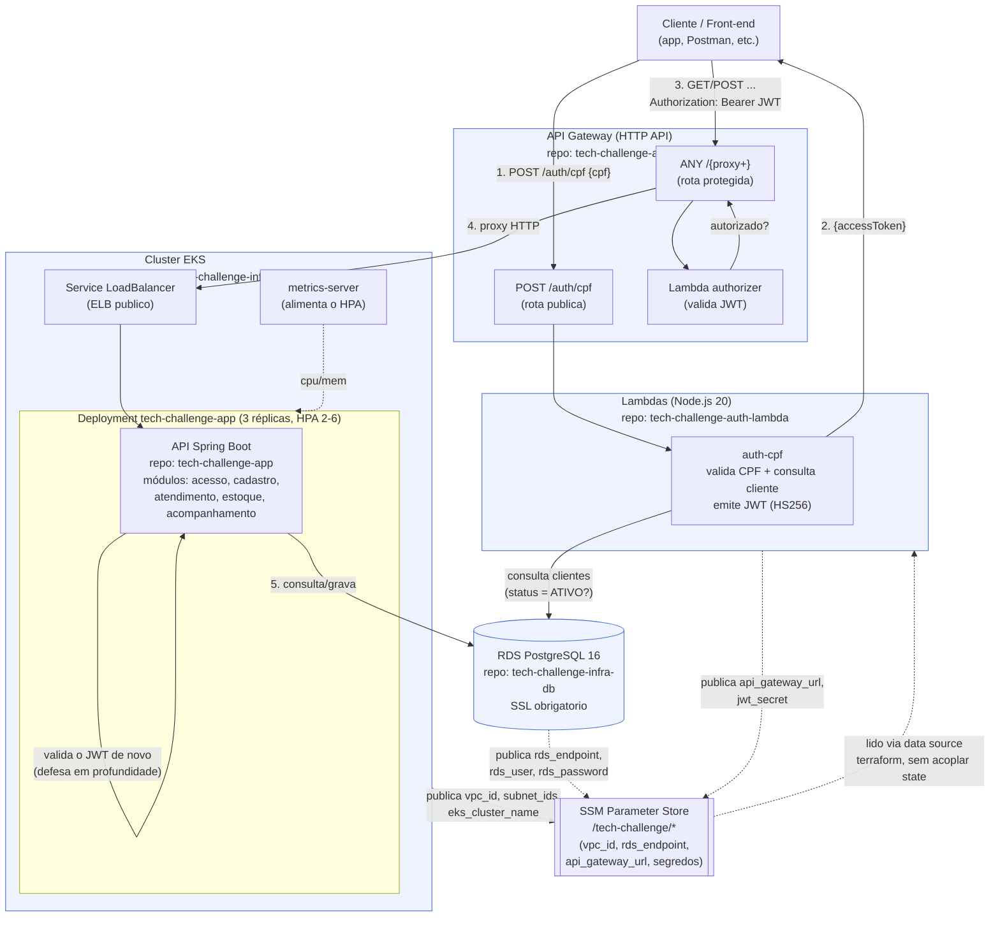

# Diagrama de Componentes

Visão de nuvem da arquitetura da Fase 3, com os 4 repositórios e como eles se conectam. Toda a infraestrutura abaixo foi provisionada e validada de ponta a ponta na AWS (ver [guia de deploy](../guia-deploy-tech-challenge-fase3.pdf) para o passo a passo e as evidências de teste).

## Componentes

| Componente | Repositório | Responsabilidade |
|---|---|---|
| **API Gateway (HTTP API)** | `tech-challenge-auth-lambda` | Porta de entrada única e pública. Roteia `/auth/cpf` (sem auth) e `/{proxy+}` (via Lambda authorizer) para a aplicação. |
| **Lambda `auth-cpf`** | `tech-challenge-auth-lambda` | Valida o dígito verificador do CPF, consulta `clientes` no RDS (existência + `status`), emite JWT HS256. |
| **Lambda `authorizer`** | `tech-challenge-auth-lambda` | Valida o `Authorization: Bearer <jwt>` antes do Gateway encaminhar a requisição — defesa na borda, sem acesso ao banco. |
| **Cluster EKS** | `tech-challenge-infra-k8s` | VPC, subnets, node group, add-ons (EBS CSI, metrics-server, StorageClass `gp3`). Plataforma onde a aplicação roda. |
| **API Spring Boot** | `tech-challenge-app` | Lógica de negócio (clientes, veículos, ordens de serviço, orçamentos, estoque). Valida o JWT de novo via OAuth2 Resource Server — a Lambda e a app compartilham o mesmo segredo HMAC. |
| **RDS PostgreSQL** | `tech-challenge-infra-db` | Banco gerenciado, único, compartilhado pela app e pela Lambda. Conexão SSL obrigatória (`rds.force_ssl=1`). |
| **SSM Parameter Store** | (todos) | Mecanismo de composição entre os 3 repositórios de infraestrutura, sem acoplar Terraform state — ver [ADR 0001](adrs/0001-padrao-comunicacao-gateway-lambda-app.md). |

## Por que essa topologia

- **Um único ponto de entrada público** (API Gateway) simplifica a superfície de ataque: o ELB da aplicação, embora público (necessário para o Gateway alcançá-lo), só deveria receber tráfego do Gateway — ver limitação conhecida na seção "Trabalhos futuros" do [RFC 0003](rfcs/0003-estrategia-de-autenticacao.md).
- **Validação de JWT em duas camadas** (Lambda authorizer na borda + Spring Security na aplicação): se o Gateway for contornado por engano, a aplicação ainda rejeita tokens inválidos.
- **Nenhum Terraform state compartilhado** entre os 3 repositórios de infraestrutura — cada um lê só o que precisa via SSM, podendo ser reaplicado independentemente (dentro da ordem de dependência: infra-k8s → infra-db → auth-lambda).
