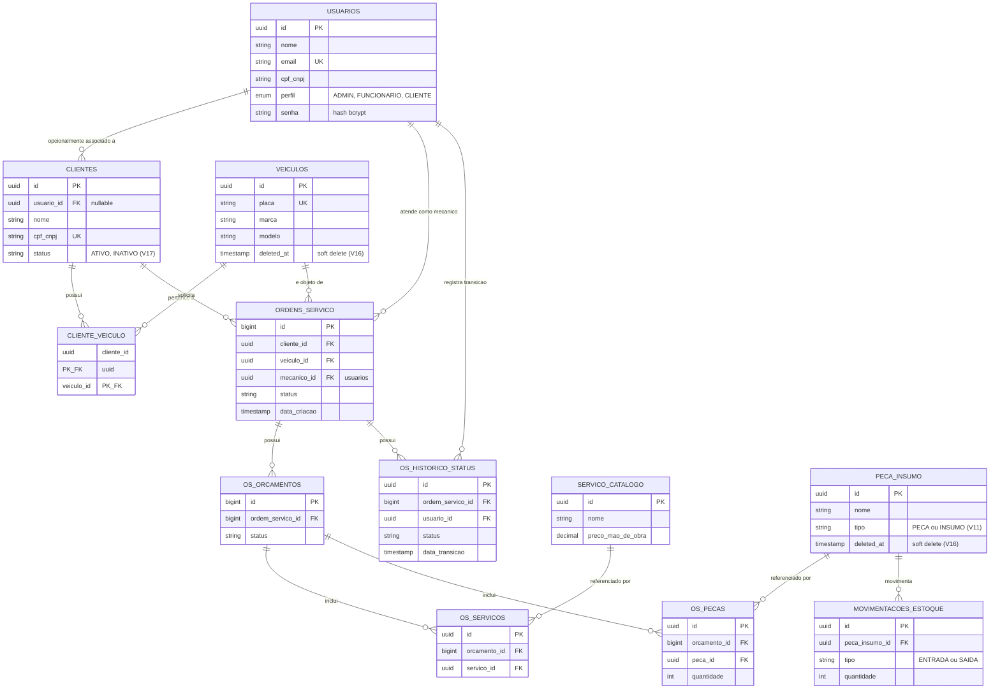

# Diagrama ER e Justificativa do Banco de Dados

## Diagrama Entidade-Relacionamento

Reflete o schema atual, construído incrementalmente pelas migrations Flyway `V1` a `V17` em [`src/main/resources/db/migration`](../src/main/resources/db/migration).

## Explicação dos relacionamentos

- **`usuarios` ↔ `clientes`** (1:0..1, opcional): um cliente *pode* ter uma conta de usuário associada (login por e-mail/senha), mas não é obrigatório — desde a Fase 3, clientes também autenticam só por CPF, sem precisar de usuário/senha (ver [RFC 0003](rfcs/0003-estrategia-de-autenticacao.md)).
- **`clientes` ↔ `veiculos`** via **`cliente_veiculo`** (N:M): um cliente pode ter vários veículos, e — embora incomum — um veículo poderia, em tese, passar por mais de um cliente ao longo do tempo (venda, por exemplo); por isso é modelado como tabela associativa em vez de FK direta em `veiculos`.
- **`ordens_servico`** referencia `clientes`, `veiculos` e `usuarios` (como mecânico responsável) diretamente — uma OS sempre amarra um cliente, o veículo dele, e quem está executando o serviço.
- **`ordens_servico` → `os_orcamentos`** (1:N): uma OS pode ter múltiplos orçamentos ao longo do seu ciclo de vida (recusados, revisados, etc.), mas só um costuma estar ativo por vez — regra de negócio da camada de aplicação, não do schema.
- **`os_orcamentos` → `os_servicos` / `os_pecas`** (1:N cada): o orçamento é a composição de serviços de mão de obra (catálogo) e peças/insumos (estoque) que, somados, formam o valor total.
- **`os_historico_status`**: tabela de auditoria — cada transição de status de uma OS (Diagnóstico → Execução → Finalização, etc.) gera uma linha, com quem fez a transição (`usuario_id`) e quando.
- **`movimentacoes_estoque`**: histórico de entrada/saída de peças e insumos, independente das OS (reposição de estoque não está necessariamente ligada a uma ordem de serviço).

## Justificativa formal da escolha do banco de dados

### Por que relacional (PostgreSQL) em vez de NoSQL

O domínio da oficina mecânica é **fortemente relacional e transacional**: uma ordem de serviço amarra cliente, veículo, mecânico, orçamento, peças (com baixa de estoque) e histórico de status — todas essas escritas precisam ser consistentes entre si (ex.: não faz sentido um orçamento referenciar peças com quantidade negativa em estoque, ou uma OS sem cliente válido). Um banco relacional com integridade referencial (`FOREIGN KEY`, `CHECK`, `UNIQUE`) garante essas invariantes no próprio banco, em vez de depender só da camada de aplicação. Um modelo de documentos (ex.: DynamoDB, MongoDB) exigiria duplicar dados entre "documentos" (cliente embutido na OS, por exemplo) ou fazer *joins* manuais na aplicação — mais código, mais chance de inconsistência, sem ganho real de performance para o volume de dados de uma oficina.

### Por que PostgreSQL especificamente (e não MySQL/SQL Server)

- **UUID nativo** (`gen_random_uuid()`) sem extensão complicada — usado como chave primária na maioria das tabelas.
- **Suporte maduro a `CHECK` constraints** com expressões arbitrárias (usado em `clientes.status`, `peca_insumo.tipo`) — permite validar enums de domínio direto no schema, sem depender só de validação na aplicação.
- Já era a escolha das fases anteriores do projeto — manter reduz risco de regressão e retrabalho de migrations.

### Por que RDS gerenciado (Fase 3) em vez de Postgres in-cluster (Fases anteriores)

Até a Fase 2, o Postgres rodava como `StatefulSet` dentro do próprio cluster EKS. Isso tinha dois problemas que a Fase 3 pedia para resolver:

1. **Acoplamento de ciclo de vida**: destruir/recriar o cluster (comum em um ambiente de laboratório AWS Academy, como discutido no guia de deploy) também destruía o banco e todos os dados.
2. **Sem backups/gerenciamento automatizado**: um StatefulSet não tem backup automático, patching de versão, nem failover — tudo manual.

RDS resolve os dois: o banco tem ciclo de vida independente do cluster Kubernetes (pode recriar o EKS sem perder dados), e ganha backup automático, patching gerenciado e (se necessário no futuro) Multi-AZ — tudo sem esforço de operação adicional. Ver [RFC 0002](rfcs/0002-escolha-do-banco.md) para a análise completa de alternativas.

### Ajustes no modelo relacional durante a Fase 3

A única mudança de schema feita especificamente para a Fase 3 foi a migration `V17__add_status_clientes.sql`, adicionando a coluna `clientes.status` (`ATIVO`/`INATIVO`, `CHECK` constraint, default `ATIVO`) — necessária para a Lambda de autenticação decidir se um CPF pode ou não gerar um token válido, sem precisar de nenhuma tabela nova.
