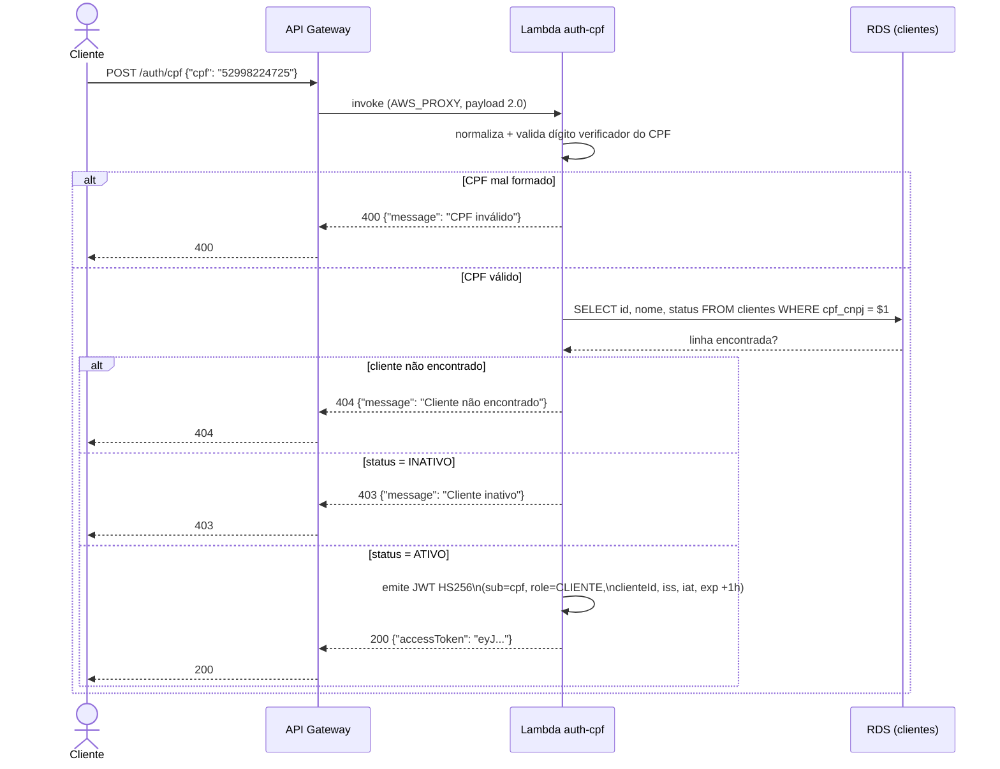
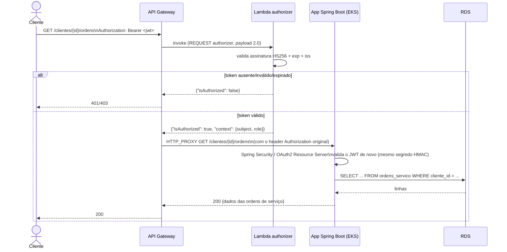
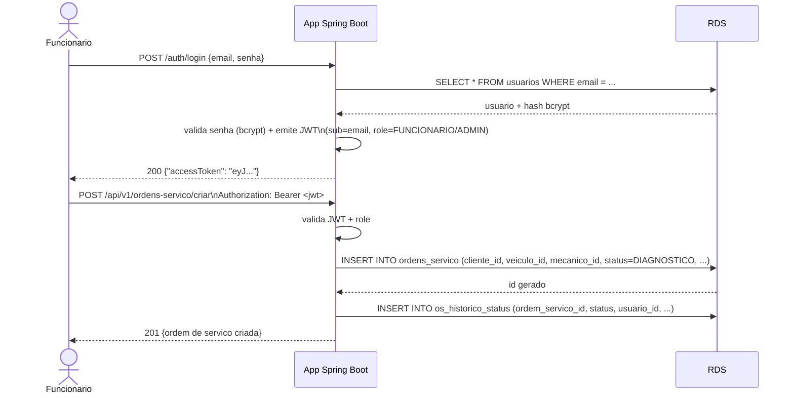

# Diagrama de Sequência

Dois fluxos: autenticação do cliente via CPF, e abertura de uma ordem de serviço já autenticado. Ambos validados de ponta a ponta na AWS real.

## 1. Autenticação via CPF

## 2. Consulta/abertura de OS autenticada (rota protegida)

### Por que validar o JWT duas vezes (authorizer + Spring Security)

O Lambda authorizer é uma defesa **na borda** (evita que tráfego não autenticado sequer alcance o cluster), mas não substitui a validação da própria aplicação: o ELB do `tech-challenge-app` é publicamente roteável (necessário para o API Gateway alcançá-lo via proxy HTTP), então, sem a segunda validação, alguém com o DNS do ELB poderia pular o Gateway inteiramente. Ver [RFC 0003](rfcs/0003-estrategia-de-autenticacao.md) para a discussão completa, incluindo a limitação conhecida (o ELB ainda aceita conexão direta, só não emite/valida nada sem um JWT válido) e a mitigação futura (VPC Link).

## 3. Abertura de uma nova ordem de serviço (autenticado como funcionário)

Esse segundo fluxo (funcionário autenticado via e-mail/senha) **não muda** com a Fase 3 — continua usando o `JwtTokenGenerator` original do `tech-challenge-app`. A Lambda só acrescenta uma *segunda via* de autenticação (CPF, para clientes), emitindo tokens no mesmo formato para não exigir nenhuma mudança no `SecurityConfig` existente.
